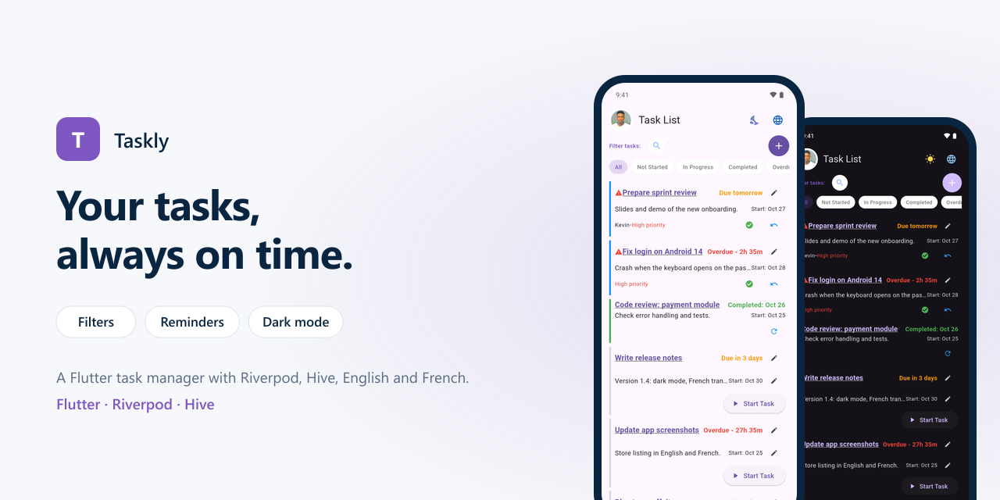
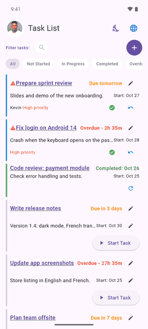
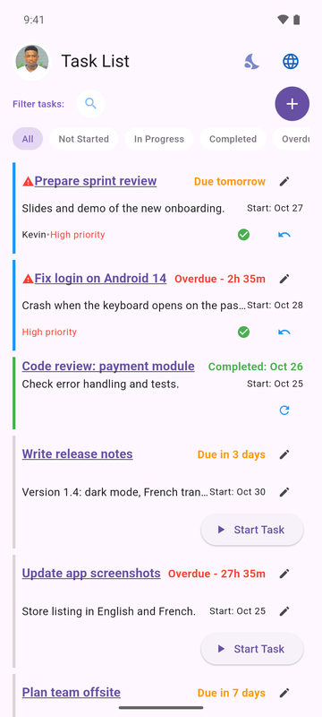
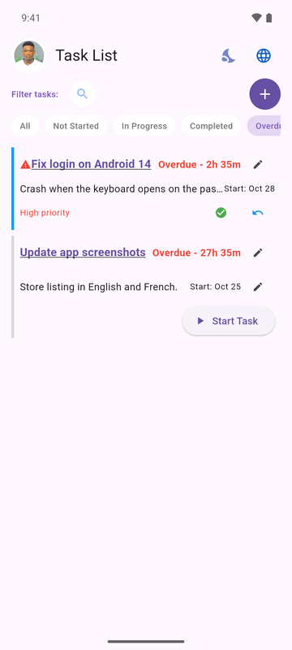
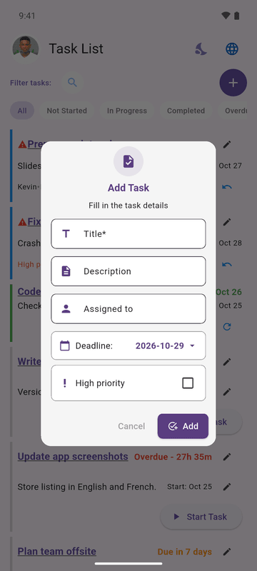
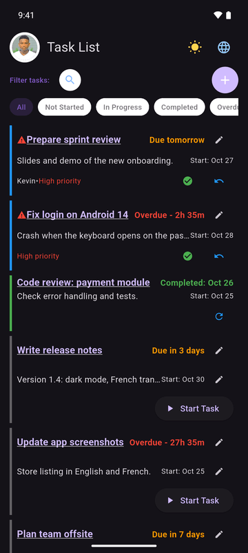
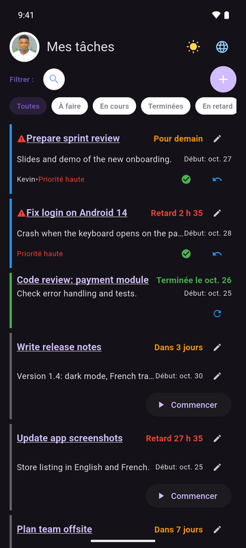

# Taskly

<p align="center"></p>


A task manager that keeps you on schedule: deadlines that tell you how much time is left, a reminder one hour before each one, and everything stored on the device.

## Screens

<p align="center"></p>

| Tasks | Overdue | New task | Dark mode | French |
|:---:|:---:|:---:|:---:|:---:|
|  |  |  |  |  |

## Features

- **Tasks** with a description, assignee, start date, deadline and a high-priority flag.
- **Status flow**: not started, in progress, completed, with undo and reopen.
- **Time left at a glance**: due today, due tomorrow, due in N days, overdue by how long.
- **Filters** (all, not started, in progress, completed, overdue) and search by name.
- **Reorder** by drag and drop, **swipe to delete** with confirmation.
- **Reminders**: a notification one hour before the deadline, rescheduled when the deadline changes and cancelled when the task is completed or deleted.
- **English and French**, **light and dark themes**, switchable from the app bar.
- **Offline**: tasks are saved on the device with Hive; sample tasks on first launch.

## How it is built

```
lib/
├── model/        Task and TaskStatus, Hive adapters (task.g.dart)
├── providers/    Riverpod notifiers: tasks, theme, locale
├── services/     Hive storage, local notifications, event log
├── screens/      task list screen and filtering
├── ui/           task card, filter bar, add dialog, reorderable list
└── l10n/         English and French strings
test/             model and sample data tests
```

The task notifier is the single place that changes tasks: it saves to Hive and keeps the matching reminder in sync, so the widgets only call it.

## Getting started

```bash
flutter pub get
flutter run
flutter test
```
